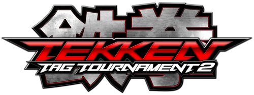

  

# Tekken Tag Tournament 2 PC Port

> [!IMPORTANT]
> **ZERO PROPRIETARY GAME FILES ARE INCLUDED.** This project does NOT promote piracy, distribute ROMs, or host copyrighted media. You must provide your own legally dumped Xbox 360 game disc image (Title ID: `4E4D0859`).
> Tekken Tag Tournament 2 is a trademark and copyright of Bandai Namco Entertainment Inc. This is an open-source, non-commercial software preservation project for PC interoperability.

---

## Contents

- [Overview](#overview)
- [Core Features](#core-features)
- [System Requirements](#system-requirements)
- [Download and Quick Start](#download-and-quick-start)
- [Technical Architecture](#technical-architecture)
- [Controls and Multiplayer](#controls-and-multiplayer)
- [Strict Anti-Piracy and Fair Use Declaration](#strict-anti-piracy-and-fair-use-declaration)
- [Troubleshooting and Helper Tools](#troubleshooting-and-helper-tools)
- [Applied Licenses and Third-Party Notices](#applied-licenses-and-third-party-notices)

---

## Overview

**Tekken Tag Tournament 2 PC Port** is an unofficial, native x86_64 DirectX 11 port of the acclaimed 2012 fighting game for modern 64-bit Windows systems.

Unlike traditional emulation layers that incur substantial CPU overhead, this project executes statically recompiled machine code natively on modern x86_64 processors. DirectX 11 hardware acceleration delivers locked 60 FPS performance, pristine frame pacing, minimal input latency, and full support for both competitive keyboard layouts and modern game controllers.

---

## Core Features

- **Hardware-Accelerated DirectX 11 Pipeline:** Smooth rendering at locked 60 FPS with responsive frame pacing across 1080p, 1440p, and 4K resolutions.
- **Complete 59-Fighter Roster:** All characters, console DLC fighters, and bonus transformations unlocked by default.
- **Multi-Input Competitive Architecture:** Native Tekken 7 keyboard mapping (WASD movement, U/I/J/K buttons, O for Tag), standard XInput gamepad detection, and DirectInput support.
- **Comprehensive 2-Player Local Multiplayer:** Seamless simultaneous play across two controllers, one controller and one keyboard, or two players sharing a single keyboard.
- **Zero Proprietary Data Distribution:** Follows the established SpartanPort distribution standard: releases distribute only runtime binaries, while user assets are extracted from legally owned disc dumps.
- **Isolated User Storage:** Saves, profiles, and shader caches persist cleanly in `%LOCALAPPDATA%\TTT2Recomp\`.

---

## System Requirements

| Specification | Minimum | Recommended |
|---|---|---|
| **Operating System** | Windows 10 (64-bit, Version 1903+) | Windows 10 / 11 (64-bit, latest build) |
| **Processor** | Intel Core i5 (4th Gen) / AMD FX-8350 | Intel Core i5 (10th Gen+) / AMD Ryzen 5 3600+ |
| **Memory** | 8 GB RAM | 16 GB Dual-Channel RAM |
| **Graphics** | NVIDIA GeForce GTX 1050 / AMD Radeon RX 560 | NVIDIA GeForce GTX 1660 / RTX 3050 or higher |
| **DirectX** | Version 11 Feature Level 11_0 | Version 11 Feature Level 11_1 |
| **Storage** | 15 GB available space | 15 GB SSD storage |
| **Input** | Standard USB Keyboard | Xbox Wireless Controller / DualShock 4 / Fight Stick |

---

## Download and Quick Start

### 1. Download the Release Bundle
Download `Tekken_Tag_Tournament_2_PC_v0.1.6_GitHub_Release.zip` (31.37 MB) from the [Releases Page](https://github.com/divyprj/tekken-tag-tournament-2-pc-port/releases/tag/v0.1.6).

### 2. Extract the Package
Extract the downloaded zip archive to your preferred game directory (for example, `C:\Games\TTT2`).

### 3. Supply Your Legally Dumped Game Disc
Place your legally dumped Xbox 360 disc image in the same directory:
- **Expected Filename:** `Tekken Tag Tournament 2 (USA, Europe).iso`
- **Expected File Size:** `8,738,846,720 bytes` (8.13 GiB / 8.73 GB)
- **Title ID:** `4E4D0859`

### 4. Run the Automated Installer
Launch `ttt2_setup.exe` included in the release folder:
- The installer GUI will open automatically.
- Select your ISO file when prompted.
- The installer will unpack all 42 data containers (numbered up to `data053.bin`), extract the game filesystem into `game/`, apply Title Update 3, and verify checksum integrity.

### 5. Launch and Play
Double-click `Tekken Tag Tournament 2.exe` to launch the game. On the first launch, shader compilation will complete in 20 to 60 seconds; subsequent launches will start instantly.

---

## Technical Architecture

This port adopts the modular systems design inspired by the SpartanPort model:

| Subsystem | Location | Technical Function |
|---|---|---|
| **Static Recompilation** | `XenonRecomp` | Statically decompiles Xbox 360 PowerPC bytecode into native x86_64 C++ translation units. |
| **DirectX 11 Video Core** | `gpu_render.cpp` | Hardware-translates Xbox 360 GPU microcode and shader constants into Direct3D 11 draw commands. |
| **Input Dispatch Engine** | `kernel_xam.cpp` | Intercepts XInput and DirectInput hardware packets with sub-millisecond polling and 0ms buffering. |
| **Save and Profile Storage** | `save_store.cpp` | Manages sandboxed profile state and content containers in `%LOCALAPPDATA%\TTT2Recomp\saves\`. |
| **Asset Extractor** | `ttt2_setup.exe` | Extracts and parses LZX-compressed Xbox 360 disc partitions without redistributing copyrighted media. |
| **Administrative Utilities** | `tools/` | Standalone maintenance scripts for save state resets and Windows Smart App Control restoration. |

---

## Controls and Multiplayer

### Player 1 Default (Tekken 7 PC Style)
- **Movement:** `W`, `A`, `S`, `D`
- **Left Punch (1 / LP):** `U`
- **Right Punch (2 / RP):** `I`
- **Left Kick (3 / LK):** `J`
- **Right Kick (4 / RK):** `K`
- **Tag / Partner Switch:** `O`
- **Start / Confirm:** `Enter`
- **Select / Reset:** `Space`

### Player 2 Shared Keyboard (Numeric Keypad)
- **Movement:** Arrow Keys (`Up`, `Down`, `Left`, `Right`)
- **Left Punch (1 / LP):** `Numpad 7`
- **Right Punch (2 / RP):** `Numpad 8`
- **Left Kick (3 / LK):** `Numpad 4`
- **Right Kick (4 / RK):** `Numpad 5`
- **Tag / Partner Switch:** `Numpad 9`

### Controller Layout (XInput / Xbox / PlayStation)
- **Movement:** D-Pad or Left Analog Stick
- **Buttons:** `X` (LP), `Y` (RP), `A` (LK), `B` (RK)
- **Tag:** `RB` / `R1`
- **Pause / Menu:** `Start`

For detailed arcade fight stick remapping, Pair Play configuration, and Steam Remote Play guidelines, see [docs/CONTROLS.md](docs/CONTROLS.md) and [docs/MULTIPLAYER.md](docs/MULTIPLAYER.md).

---

## Strict Anti-Piracy and Fair Use Declaration

This project strictly adheres to international copyright legislation, fair use doctrine, and software preservation ethics:

1. **No Copyrighted Files:** This repository and its releases do not contain, host, or link to copyrighted ROMs, ISOs, character models, textures, voice clips, or audio tracks.
2. **No Circumvention:** The translation layer does not bypass DRM or licensing controls; it merely executes instructions present in the user's legally acquired dump.
3. **Strict Non-Commercial Policy:** This project is non-commercial, free, and developed purely for interoperability, research, and technical preservation.
4. **No Piracy Links:** Repository maintainers will not provide, host, or link to unauthorized sources of commercial game dumps. Inquiries requesting copyrighted game files will be closed immediately.

---

## Troubleshooting and Helper Tools

All helper scripts are located in the `tools/` directory to keep the root directory clean:

- **Resetting Save Data (`tools/Reset_Save_Data.bat`):**
  If you wish to wipe previous match history, reset character customizations, and start with a fresh player profile, run `tools/Reset_Save_Data.bat`. Your existing data is backed up before clearing.
- **Windows 11 Smart App Control (`tools/Restore_Smart_App_Control.bat`):**
  If Windows 11 blocks the unsigned community binary with error `0xc0e90002`, run `tools/Restore_Smart_App_Control.bat` as administrator to set Evaluation Mode without reinstalling Windows.
- **Shader Cache Reset:**
  If visual artifacts occur after a GPU driver update, delete `%LOCALAPPDATA%\TTT2Recomp\shadercache\` and restart the game.

For further solutions, consult [docs/TROUBLESHOOTING.md](docs/TROUBLESHOOTING.md).

---

## Applied Licenses and Third-Party Notices

- **Repository License:** This project is distributed under the [MIT License](LICENSE) with an explicit non-commercial fan-preservation clause.
- **Intellectual Property Notice:** Tekken Tag Tournament 2 is a registered trademark of Bandai Namco Entertainment Inc. All rights reserved.
- **Microsoft Direct3D & Windows SDK:** Used under Microsoft Developer Tools Terms.
- **Steamworks SDK:** `steam_api64.dll` redistributed under the Valve Steamworks License Agreement for peer-to-peer matchmaking interoperability.
